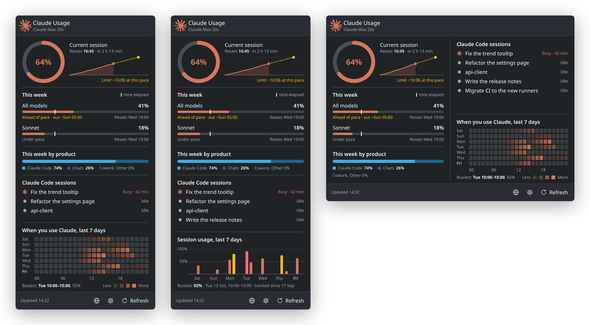

# Claude Usage — a Plasma 6 panel widget

[github.com/samsam07/plasma-claude-usage](https://github.com/samsam07/plasma-claude-usage)



Shows how much of your Claude plan's limits you have used, as a ring around the
Claude mark in the system tray, next to the network and volume icons. Click it
for the current session with its pace, this week's limits, this week's usage
split by product, your running Claude Code sessions, and when you used Claude
over the last seven days. The figures are the ones Claude Code's `/usage`
screen shows, read with Claude Code's own sign-in.

The ring is Claude orange, then turns yellow and red as the limit fills.

## Requirements

- KDE Plasma 6
- [Claude Code](https://claude.com/claude-code), signed in with a Claude
  subscription (Pro, Max, Team or Enterprise). An API-key login has no plan
  limits to show.

## Install

```sh
git clone https://github.com/samsam07/plasma-claude-usage.git
cd plasma-claude-usage
./install.sh
```

To show it with the other tray icons: right-click the system tray's arrow →
**Configure System Tray…** → **Entries** → **Claude Usage** → **Always shown**.
If it is not listed yet, reload the shell first (see below).

To place it on a panel by itself instead: right-click the panel →
**Add or Manage Widgets…** → **Claude Usage**.

If the widget is already showing when you reinstall, reload the shell to pick
up the changes:

```sh
kquitapp6 plasmashell && (kstart plasmashell >/dev/null 2>&1 &)
```

`./uninstall.sh` removes it.

## Settings

Right-click the widget → **Configure Claude Usage…**

| Setting | Default | Notes |
| --- | --- | --- |
| Ring shows | Current session | The 5-hour session, the week across all models, or whichever is closest to its limit. The popup always leads with the session |
| Panel icon while a session works | Spark frames | Or Petal wave, Turning mark, Orbit, or No animation; see [Claude Code sessions](#claude-code-sessions) |
| Popup shows | Everything | Each section can be hidden: the current session, this week's limits and credits, this week by product, Claude Code sessions, the last seven days, and the settings button |
| Sessions: only those working | Off | |
| Last seven days as | When you use Claude, by the hour | Or each session's peak, as bars |
| Turn yellow at | 75% | |
| Turn red at | 90% | |
| Refresh every | 5 minutes | At least 2; see [Rate limit](#rate-limit) |
| Credentials file | `~/.claude/.credentials.json` | Change only if you run Claude Code with `CLAUDE_CONFIG_DIR`. Sessions are read from `sessions/` in the same directory |

## How it behaves

- The ring shows one limit. The popup leads with the current session, then
  this week's limits, usage credits if you have them switched on, and this
  week's usage by product. Below them, or in a second column once the popup is
  600 px wide, come your Claude Code sessions, which take whatever room is
  spare, and the last seven days at the bottom.
- Percentages are rounded down, as Claude Code rounds them: 99.6% reads `99%`.
- The session reads `Resets 16:45 · in 2 h 13 min`. A weekly limit reads
  `Resets in 5 h 2 min` when under a day away, otherwise `Resets Wed 19:00`.
- Once a window's reset time passes, it drops to 0% straight away, and the
  widget fetches the new figures without waiting for the next refresh.
- Opening the popup refreshes it if the figures are more than a minute old.

### Current session and pace

Next to the ring, a chart of the session so far: from 0% when the 5-hour
window began, through every figure the widget fetched, to now. A dashed line
carries on at the pace of the last hour, and the line under the chart says
where it leads: `Limit ~16:06 at this pace` in yellow when that comes before
the reset, otherwise `~80% by reset at this pace`. The pace waits for 15
minutes of figures, as a line through a few minutes swings too much.

Each weekly bar has a tick for how much of the week has gone. A limit used
faster than that is `Ahead of pace`, with when it would run out at its average
rate since the week began, such as `out ~Sun 05:00`; otherwise it is
`Under pace`. A week's pace waits for its first 6 hours.

### Usage by product

Claude Code, Chats, Cowork and Other, each as a share of this week's usage,
exactly as claude.ai's usage page lists them, in one split bar. The shares add
up to 100% of what you have used, not of your limit. Products with no share
are named together on one line. The bar uses your Plasma accent colour, so it
doesn't look like the limit bars' orange, yellow and red.

### Claude Code sessions

The Claude Code sessions open on this computer, working ones first, then the
most recently active, one line each: its name, and `Busy` with how long it has
been running, or `Idle`. The list shows as many as fit in the room it has,
which is at least three lines, and counts the rest on the last line, such as
`+2 idle sessions`.

While any of them is working, the panel icon animates, in the style chosen in
the settings:

- **Spark frames**, the default: the mark becomes the spark Claude Code
  itself steps through, `· ✢ ✳ ✶ ✻ ✽` and back, a frame every 375 ms.
- **Petal wave**: a spark whose eight rays swell and settle in a wave that
  travels round it, once every 1.4 s.
- **Turning mark**: the Claude mark turns once every 3.2 s and breathes.
- **Orbit**: the mark stays still, and a light laps the usage ring every 1.6 s.

A working session's row in the popup shows the petal wave when that is
chosen, and the spark frames otherwise. Like Plasma's own busy indicators, the
animations keep moving with Plasma's animations set to Instant; choose
**No animation** instead.

They come from the files Claude Code keeps in `~/.claude/sessions`, one per
process. A file only counts while its process is alive and started when the
file says, so a crashed session or a reused process id is not listed.
Claude Code's background jobs and spare processes are left out. The widget
re-reads the directory every 3 seconds while the popup is open and every 10
while it is closed, and stops when both the list and the panel animation are
switched off.

### Last seven days

By default, **when you use Claude**: one row per day, today last, and a cell
per hour coloured by how much of the session limit went in that hour, the
busiest hour strongest. The other choice in the settings is **each session's
peak**: one column per 5-hour session, placed at the time it ran, as tall as
the highest percentage it reached, and coloured by the same thresholds as the
ring. Point at a cell or a column, or tab to the chart and use the arrow keys,
to read it out. Otherwise the line under the chart names the busiest session.

The usage service reports only the session in progress, so **the widget
records this history itself**. Each refresh saves the session's figure. What
it rose by since the last refresh is spread over the time between them, hour
by hour, as nothing says when within it. The widget also checks once more just
before a session resets, to catch where it ended.

- The charts start empty and fill in over the first week. Hours before
  recording began are drawn fainter, and the stretch before it is shaded.
- Sessions that ran while the widget wasn't running (computer off, logged out)
  are missing, and look the same as sessions that never happened.
- How finely the hours are told apart depends on **Refresh every**: at the
  5-minute default, a rise is placed within 5 minutes.
- The history is kept per account next to the cache, and trimmed to eight days.

### Rate limit

The usage endpoint is rate limited. The limit is shared with Claude Code's own
`/usage` screen, so a widget that polls too often can make that screen fail
too. Refreshing every minute or two was enough to hit the limit in testing,
hence the 5-minute default. When the service answers `429`, the widget keeps
its figures and waits at least 5 minutes, doubling up to 30, before trying
again. The service's `retry-after` header says `0`, so it isn't useful.

Restarting Plasma doesn't reset that wait: the widget saves it and waits it
out after a restart. Nor does a restart fetch straight away when the saved
figures are less than one refresh old. They are shown as they are, and the
next fetch comes when they are due.

### Colours

These are Claude Code's own theme colours. It ships separate sets for dark and
light backgrounds, so the widget picks the set that suits your Plasma theme.

| State | When | Dark | Light |
| --- | --- | --- | --- |
| Orange | below the yellow threshold | `#d77757` | `#d77757` |
| Yellow | at or past **Turn yellow at** | `#ffc107` | `#966c1e` |
| Red | at or past **Turn red at** | `#ff6b80` | `#ab2b3f` |

In the dark set, the orange and the red are close enough to be hard to tell
apart at a glance, especially with red-green colour blindness. The length of
the ring and the percentages carry the same information.

Claude decides when to warn you on its own servers, so Claude Code has no fixed
percentage to copy. The thresholds are this widget's defaults, but the usage
response also rates each limit's severity. If that rating is higher than the
percentage alone gives, the colour follows the rating.

### Sign-in

The widget reads `accessToken` from Claude Code's credentials file before
every refresh, sends it to `api.anthropic.com` and nowhere else, and holds it
in memory only until that request finishes.

It never renews the sign-in or writes to the file. Renewing a sign-in replaces
the stored refresh token, and doing that from a second program would log Claude
Code out. Claude Code renews its own sign-in whenever you use it, and the
widget picks up the new token on its next refresh.

If the sign-in has lapsed because Claude Code has not been used for a while,
the widget keeps showing the last figures it fetched, dimmed and marked with
`⚠`. The last response is cached per account in SQLite
(`~/.local/share/plasmashell/QML Offline Storage/`), so the ring is filled in
as soon as Plasma starts.

## Layout

```
package/contents/
├── code/usage.js      all usage logic, free of QML types so it can be tested
├── config/            settings schema and page registration
├── icons/claude.svg   the Claude mark
└── ui/
    ├── main.qml                   sign-in, fetching, caching, timers, applet state
    ├── CompactRepresentation.qml  the ring in the panel or tray
    ├── FullRepresentation.qml     the popup
    ├── UsageRing.qml              the ring itself, used in both
    ├── SessionChart.qml           the current session so far, and its pace
    ├── LimitRow.qml               one limit's bar in the popup
    ├── ProductSplit.qml           this week's split by product
    ├── SessionList.qml            the Claude Code sessions that fit
    ├── SessionRow.qml             one running Claude Code session
    ├── ClaudeSpinner.qml          the spark shown while a session works
    ├── SessionHeatmap.qml         when you used Claude, by the hour
    ├── SessionTrend.qml           each session's peak, as bars
    └── configGeneral.qml          the settings page
```

`main.qml` owns all state and hands itself to the representations as `applet`,
because QML ids do not cross file boundaries.

## Tests

```sh
./tests/run-tests.sh    # usage logic, against real and synthetic responses
./tests/try-run.sh      # loads the applet and reports any QML errors
```

`run-tests.sh` runs `usage.js` under `gjs`, with `TZ=UTC` so the chart's day
boundaries are predictable. `tests/fixture-usage.json` is a real response from
the endpoint, whose product split matches what claude.ai showed at the time.
`tests/fixture-near-limit.json` is synthetic, with made-up figures and
severities that cover the warning, critical, per-model and usage-credit cases a
lightly used account never returns.

## Data source

```
GET https://api.anthropic.com/api/oauth/usage
Authorization: Bearer <Claude Code access token>
anthropic-beta: oauth-2025-04-20
```

This is the request behind Claude Code's `/usage` screen. The response has
`five_hour` and `seven_day` windows with a `utilization` percentage and a
`resets_at` time, and a `limits` array that adds a `severity` to each window,
plus per-model weekly limits on plans that have them. `seven_day_breakdown`
holds the week's split by product. It also reports usage credits when those
are switched on. There is no history; see [Last seven days](#last-seven-days).

The endpoint is undocumented, so it can change without warning. If the widget
stops updating, check it first. A failed fetch does not clear the widget: it
keeps the last figures and retries with a backoff.

## Credits

The Claude mark is from [Simple Icons](https://simpleicons.org) (CC0). Claude is
a trademark of Anthropic. This project is not affiliated with or endorsed by
Anthropic.

## License

MIT — see [LICENSE](LICENSE). Copyright (c) 2026 Hisham Maudarbocus.
